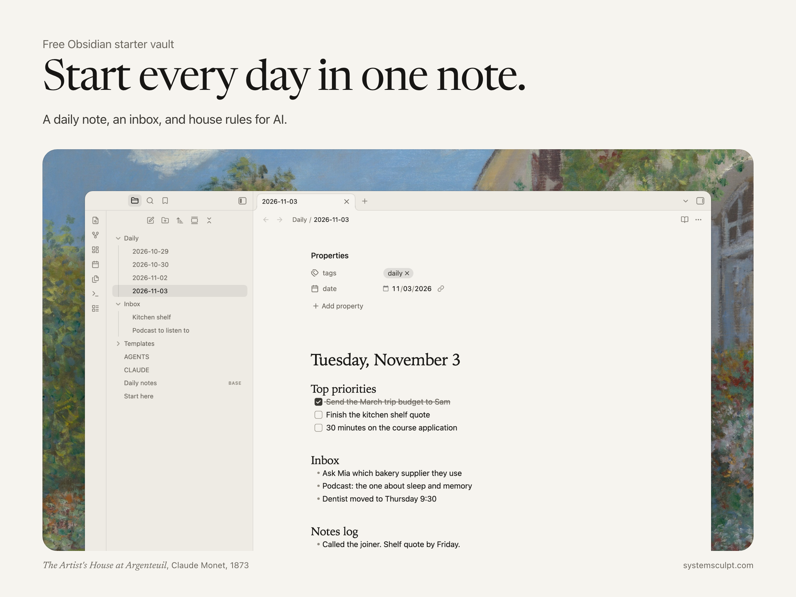

# Obsidian starter vault

A daily note, an inbox and house rules for AI. Free, from [SystemSculpt](https://systemsculpt.com).

## Use it

1. [Download the zip](https://systemsculpt.com/downloads/systemsculpt-starter-vault.zip), or clone this repo.
2. In Obsidian, choose **Open folder as vault** and pick `Starter vault`.
3. Click **Open today’s daily note** in the left ribbon.

## What’s inside

- **Daily note.** Opens by itself each morning: priorities, inbox, notes, open loops and an end-of-day review.
- **Inbox.** New notes land there until you sort them.
- **AGENTS.md and CLAUDE.md.** House rules Claude Code and Codex read before they change anything.
- **Daily notes view.** Every day you’ve written, in one table.

Plain Markdown. Core plugins only: Daily notes, Templates and Bases.

To chat with Claude Code or Codex inside Obsidian, add the free [SystemSculpt plugin](https://obsidian.md/plugins?id=systemsculpt-ai).

## Want more?

The **AI-ready vault** adds folders, eight agent skills, 60 prompts and an inbox for iPhone captures. See it in the [SystemSculpt shop](https://systemsculpt.com/shop/ai-ready-vault).

## Licence

[CC BY 4.0](https://creativecommons.org/licenses/by/4.0/): use, change and share it, with credit to SystemSculpt.
